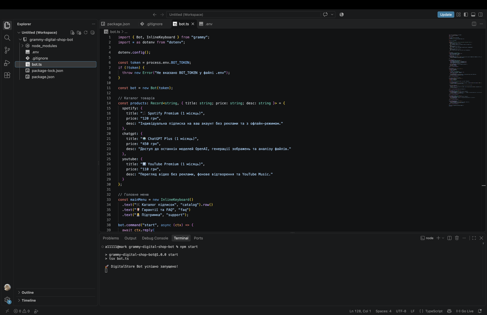
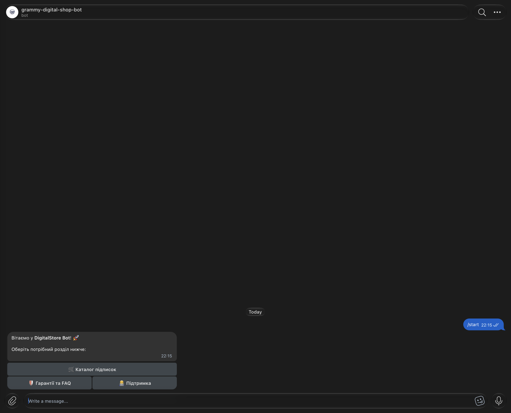

# 🛒 Digital Subscriptions Store Bot (Telegram + TypeScript + grammY)

An automated Telegram storefront bot designed for selling digital subscriptions and access packages (demonstrated on Spotify, ChatGPT Plus, and YouTube Premium). Built with **TypeScript**, **Node.js**, and the **grammY** framework.

---

## 🖼 Architecture & Demo

### TypeScript Bot Architecture (VS Code)

### Live Telegram Demo

---

## ✨ Key Features (English)

* **24/7 Automated Storefront:** Uses `InlineKeyboard` menus via the `grammY` framework to display product categories, pricing, and delivery terms without manual operator replies.
* **Dynamic Callback Routing:** Regex-based handlers (`item_(.+)` and `buy_(.+)`) dynamically render product cards and process orders in a single message window without spamming the chat.
* **Automated Order ID Generation:** Generates unique 4-digit order numbers (`#1000–#9999`) upon checkout and confirms the purchase to the customer immediately.
* **Instant Admin Alerts:** Automatically sends a formatted lead card (`[АДМІН-ПАНЕЛЬ] Нове замовлення!`) with the buyer's `@username`, selected plan, and price directly to the store owner's Telegram.

---

## 🇺🇦 Опис проєкту (Українською)

Швидкий Telegram-бот вітрина для автоматизації продажу цифрових підписок та обробки замовлень без участі менеджера на етапі вибору товару.

### Як працює система:
1. **`/start` & `mainMenu (InlineKeyboard)`** — зустрічає клієнта та виводить інтерактивне меню з розділами «Каталог підписок», «Гарантії та FAQ» і «Підтримка».
2. **`catalog` + `products Dictionary`** — динамічно підтягує актуальні ціни, опис тарифів і час видачі для кожної позиції (Spotify, ChatGPT Plus, YouTube Premium).
3. **`Callback Query Router` (`item_*` → `buy_*`)** — оновлює повідомлення при перемиканні між товарами без засмічення історії чату та формує унікальний номер замовлення.
4. **`Order Confirmation` → `ctx.api.sendMessage (Admin Alert)`** — покупець отримує підтвердження з номером замовлення, а адміністратору миттєво надходить картка нового клієнта з його нікнеймом і сумою до сплати.

---

## 🚀 Quick Start / Як запустити у себе

1. Install **Node.js (LTS)** on your machine.
2. Clone this repository and open the project folder in **VS Code**.
3. Run `npm install` in the terminal to install `grammY` and `TypeScript` dependencies.
4. Create a `.env` file in the root folder and add your **Telegram Bot Token** (from `@BotFather`): `BOT_TOKEN=your_token`.
5. Run `npm start` in the terminal and send `/start` to your bot in Telegram!
